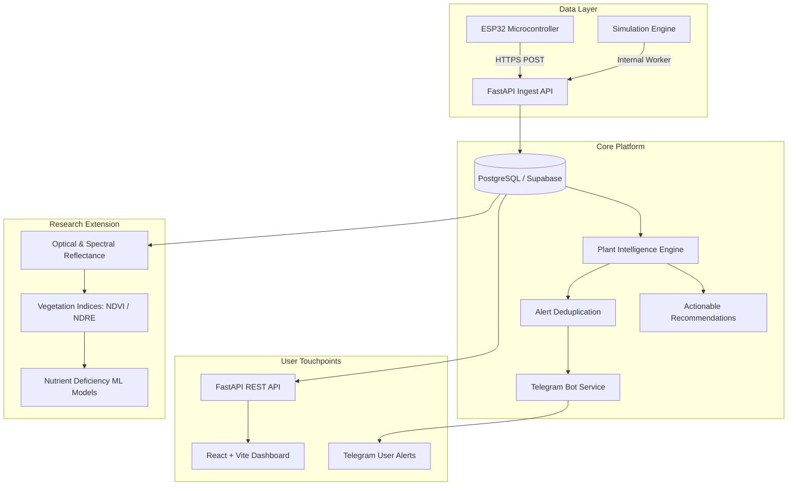

# PlantCare AI 🌿 — Intelligent Plant Monitoring & Care Platform

[](LICENSE)
[](frontend/)
[](backend/)
[](backend/)
[](hardware/)
[](telegram/)

> **PlantCare AI** is a full-stack, modular, and extensible engineering research platform for real-time plant telemetry monitoring, automated health diagnostics, Telegram notification dispatch, and early nutrient deficiency detection via IoT sensor fusion and machine learning.

---

## 🔬 Engineering & Research Context

This project serves as the foundational platform for the research initiative:
> *"Design and Development of a Low-Cost IoT-Enabled Chlorophyll Sensing System with Sensor Fusion and Machine Learning for Early Detection of Nutrient Deficiency in Crops."*

The architecture is explicitly partitioned into:
1. **Core Environmental Monitoring:** Real-time acquisition and evaluation of soil moisture, ambient temperature, relative humidity, and light intensity.
2. **Plant Intelligence Engine:** Deterministic botanical heuristics comparing sensor readings against plant species thresholds with transparent, explainable recommendations.
3. **Research & ML Integration Module:** Future optical sensing (red & near-infrared reflectance), vegetation index computation (NDVI/NDRE/CI), and multi-spectral sensor fusion for crop nutrient deficiency classification.

---

## 🌟 Key Features

- 📊 **Agricultural SaaS Web Dashboard:** Modern, responsive desktop and mobile interface with clean botanical styling, interactive Recharts telemetry graphs, and dark mode.
- 🪴 **Multi-Plant Management:** Monitor individual botanical profiles (Tomato, Monstera, Basil, Peace Lily, Succulent, etc.) with custom threshold limits.
- 🧪 **Dynamic Sensor Simulator:** Built-in multi-scenario simulation engine (Normal, Drought Stress, Overwatering, Heat Stress, Recovery) for out-of-the-box operation without physical hardware.
- ⚡ **Hardware-Agnostic Ingestion API:** `POST /api/v1/sensors/readings` endpoint ready for physical ESP32 microcontrollers with token authentication.
- 🤖 **Interactive Telegram Bot:** Direct communication using the official Telegram Bot API (`/status`, `/report`, `/advice`, `/plants`) with intelligent alert deduplication.
- 🧠 **Explainable Intelligence Engine:** Identifies stress conditions and provides actionable care advice with full scientific evidence logging.
- 🔒 **Zero-Trust Security:** Strict segregation of public frontend configuration and private backend credentials.

---

## 🏗️ System Architecture



---

## 🛠️ Technology Stack

| Domain | Technologies |
|---|---|
| **Frontend** | React 18, TypeScript, Vite, Tailwind CSS, Recharts, Lucide React |
| **Backend** | Python 3.13, FastAPI, Pydantic v2, Uvicorn, SQLAlchemy |
| **Database** | Supabase (PostgreSQL) / Async SQLite for development |
| **Messaging** | Telegram Bot API (Async HTTP) |
| **Hardware / IoT** | ESP32, Capacitive Soil Moisture, DHT22/BME280, BH1750, Optical Sensors |
| **Machine Learning** | Scikit-learn, NumPy, Pandas, PyTorch (Future Research Stage) |

---

## 📂 Repository Structure

```
PlantCare-AI/
├── .github/                  # CI/CD workflows, issue & PR templates
│   ├── workflows/ci.yml
│   ├── ISSUE_TEMPLATE/
│   └── pull_request_template.md
├── frontend/                 # React + TypeScript + Vite Dashboard
│   ├── public/
│   ├── src/
│   │   ├── components/       # Reusable UI components & cards
│   │   ├── pages/            # 10 Dashboard sections
│   │   ├── services/         # API client & mock data handlers
│   │   ├── types/            # TypeScript data models
│   │   └── App.tsx
│   ├── package.json
│   └── tailwind.config.js
├── backend/                  # FastAPI Python backend
│   ├── app/
│   │   ├── api/v1/           # API endpoints (plants, sensors, devices)
│   │   ├── core/             # Configuration, database connection, security
│   │   ├── models/           # SQLAlchemy database entities
│   │   ├── schemas/          # Pydantic validation schemas
│   │   ├── services/         # Intelligence, Telegram bot, Simulator
│   │   └── main.py           # Application entrypoint
│   ├── requirements.txt
│   └── tests/
├── hardware/                 # ESP32 firmware & schematics
│   ├── esp32_plantcare.ino   # Arduino C++ production firmware
│   └── README.md             # Pinout wiring & flashing instructions
├── research_ml/              # Agricultural ML & optical sensing module
│   ├── notebooks/            # Exploratory research notebooks
│   ├── models/               # Model architectures and weights
│   └── README.md             # Optical chlorophyll sensing methodology
├── .env.example              # Environment configuration template
├── .gitignore                # Comprehensive Git ignore rules
├── CONTRIBUTING.md           # Contribution guidelines & branch strategy
├── LICENSE                   # MIT License
└── README.md                 # Primary project documentation
```

---

## 🚀 Quick Start Guide

### 1. Clone & Configure
```bash
git clone https://github.com/Yash-glitch-byte/PlantCare-AI.git
cd PlantCare-AI
cp .env.example .env
```

### 2. Start the Backend
```bash
cd backend
python -m venv .venv

# Activate virtual environment
# Windows:
.venv\Scripts\activate
# Linux/macOS: source .venv/bin/activate

pip install -r requirements.txt
uvicorn app.main:app --reload --port 8000
```
Interactive API documentation: `http://localhost:8000/docs`

### 3. Start the Frontend
```bash
cd ../frontend
npm install
npm run dev
```
Access the dashboard: `http://localhost:5173`

---

## 🗺️ Development Roadmap

- [x] **Phase 1:** GitHub repository verification, clean Git architecture, CI/CD pipeline, and licensing.
- [ ] **Phase 2:** Complete 10-section React + Tailwind monitoring dashboard with live charts & theme switching.
- [ ] **Phase 3:** FastAPI asynchronous backend with SQLAlchemy models and Supabase schema.
- [ ] **Phase 4:** Telegram Bot integration with deduplicated alerting and command handlers.
- [ ] **Phase 5:** Multi-scenario sensor simulator (Normal, Drought, Overwatering, Heat, Recovery).
- [ ] **Phase 6:** Hardware-independent ESP32 REST ingest API, token auth, and Arduino firmware sketch.
- [ ] **Phase 7:** Research module for optical chlorophyll sensing and nutrient deficiency estimation.
- [ ] **Phase 8:** Test coverage verification, deployment guides for Vercel and Render.

---

## 📄 License & Maintainer

Maintained by **Yash** ([@Yash-glitch-byte](https://github.com/Yash-glitch-byte)).  
Released under the [MIT License](LICENSE).
