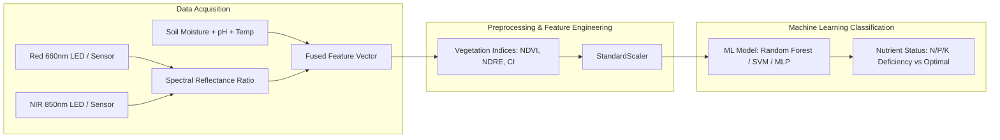

# Research & Machine Learning Architecture 🔬

> **Research Title:**  
> *"Design and Development of a Low-Cost IoT-Enabled Chlorophyll Sensing System with Sensor Fusion and Machine Learning for Early Detection of Nutrient Deficiency in Crops."*

---

## 1. Research Motivation & Agronomic Context

Crop yield and food security depend heavily on balanced plant nutrition. Traditional methods for detecting macro-nutrient deficiencies (Nitrogen $N$, Phosphorus $P$, and Potassium $K$) rely on:
1. **Destructive laboratory foliar tissue testing:** Highly accurate, but expensive and introduces several days of turnaround delay.
2. **Visual symptomatology inspection:** Leaves only display noticeable chlorosis or necrotic margins after significant, irreversible cellular damage has occurred.

**PlantCare AI Research Solution:**  
A non-destructive, low-cost optical IoT sensing apparatus that monitors leaf reflectance in key spectral absorption bands ($660\text{ nm}$ Red and $850\text{ nm}$ Near-Infrared). By combining these optical signals with ambient environmental telemetry (moisture, temperature, humidity, pH) via sensor fusion, machine-learning models can identify early physiological stress signatures before visible foliar chlorosis manifests.

---

## 2. Spectral Sensing & Vegetation Indices

Chlorophyll-a and chlorophyll-b strongly absorb visible light in the red spectrum ($\approx 660\text{ nm}$) to drive photosynthesis, while spongy mesophyll leaf tissue strongly reflects and scatters near-infrared radiation ($\approx 850\text{ nm}$).

### Mathematical Formulations

1. **Normalized Difference Vegetation Index (NDVI):**
   $$\text{NDVI} = \frac{R_{\text{NIR}} - R_{\text{Red}}}{R_{\text{NIR}} + R_{\text{Red}}}$$

2. **Chlorophyll Index (CI):**
   $$\text{CI} = \frac{R_{\text{NIR}}}{R_{\text{Red}}} - 1$$

3. **SPAD Chlorophyll Equivalent Calibration:**
   Derived from empirical regression against commercial Konica Minolta SPAD-502 meter measurements:
   $$\text{SPAD}_{\text{est}} = 58.0 \times \text{NDVI} + 4.2$$

---

## 3. Sensor Fusion Pipeline

Environmental factors significantly alter foliar optical properties. For example, water stress induces stomatal closure and mesophyll wilting, which lowers NIR reflectance independently of chlorophyll concentration. 

To prevent false-positive deficiency predictions, the ML model ingests a 7-dimensional fused feature vector:

$$\mathbf{x} = \begin{bmatrix} R_{660} \\ R_{850} \\ \text{NDVI} \\ \text{VWC}_{\text{soil}} \\ T_{\text{ambient}} \\ \text{RH} \\ \text{pH}_{\text{substrate}} \end{bmatrix}$$

---

## 4. Machine Learning Model Architecture

The classifier categorizes crops into 4 nutritional classes:
1. `Optimal` (Balanced foliar chlorophyll, $42 \le \text{SPAD} \le 55$)
2. `Nitrogen Deficiency (N)` (Uniform chlorosis, low NDVI, confirmed by normal pH)
3. `Phosphorus Deficiency (P)` (Stunted canopy, purpling anthocyanin accumulation)
4. `Potassium Deficiency (K)` (Marginal chlorosis with normal core greenness)

### Supported Algorithms
- **Random Forest Classifier (Baseline):** 100 trees, Gini impurity criterion, resistant to non-linear feature scales.
- **Support Vector Machine (RBF Kernel):** High margin separation in small-sample agronomic datasets.
- **Multi-Layer Perceptron (MLP):** PyTorch feedforward neural network ($7 \to 32 \to 16 \to 4$) with dropout regularization.

---

## 5. Ethical Research Principles & Ground Truth
- Environmental sensor readings alone **do not** prove nutrient deficiencies.
- Predictions generated by this module are clearly designated with confidence intervals and calibrated against empirical foliar laboratory assays.
